<div align="center">
  

  # VibeDownloader

  ### Free video & music downloader for Windows, macOS and Linux

  <a href="https://github.com/naeem5877/vibedownloader-desktop/releases/latest">
    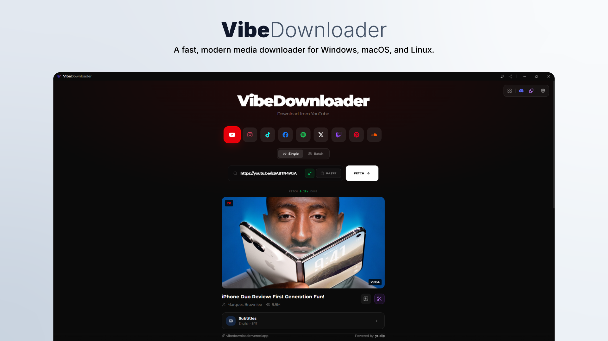
  </a>
</div>

<br />

<div align="center">

**Download videos, audio, subtitles, lyrics and playlists from YouTube, Instagram, TikTok, Spotify and more.**
<br />
Local. Ad-free. Private by design. Powered by `yt-dlp`.

<sub>A free, open-source YouTube downloader, Spotify downloader, TikTok, Instagram, Facebook and Twitch video saver, with a built-in video converter, GIF maker and browser extension. Also on Android, and as a Premiere Pro plugin for video editors.</sub>

<br />

<a href="https://github.com/naeem5877/vibedownloader-desktop/releases/latest"></a>
<a href="https://github.com/naeem5877/vibedownloader-desktop/releases/latest"></a>
<a href="https://github.com/naeem5877/vibedownloader-desktop/releases/latest"></a>
<a href="https://github.com/naeem5877/vibedownloader-android/releases/latest"></a>
<a href="https://github.com/naeem5877/vibe-plugin/releases/latest"></a>

<a href="https://github.com/naeem5877/vibedownloader-desktop/releases/latest"></a>
<a href="https://github.com/naeem5877/vibedownloader-desktop/releases"></a>
<a href="https://github.com/naeem5877/vibedownloader-desktop/stargazers"></a>
<a href="LICENSE"></a>
<a href="https://vibedownloader.vercel.app"></a>

<br />

[Quick start](#quick-start) · [Features](#features) · [Platforms](#platforms) · [Install](#install) · [What's New](#whats-new) · [Extension](#extension) · [Android](#android) · [Premiere](#premiere-plugin) · [Help](#troubleshooting) · [Develop](#develop)

</div>


<a id="why"></a>

## 🌟 Why VibeDownloader?

<table>
<tr>
<td width="33%" valign="top">

### 🔒 Private by design
Everything runs **on your device**. No accounts, no ads, and no tracking of what you download.

</td>
<td width="33%" valign="top">

### ⚡ Powered by yt-dlp
The industry-standard engine, kept current with a one-click update in Settings — and a failed update never leaves you without a working downloader.

</td>
<td width="33%" valign="top">

### 🎛️ Full control
Pick the exact quality, audio language, format and clip. Trim, convert or turn a moment into a GIF before you save.

</td>
</tr>
</table>

<a id="quick-start"></a>

## 🚀 Quick Start

Three steps, about a minute.

<table>
<tr>
<td width="33%" valign="top">

### 1️⃣ Install
Get the installer for your system from the [**Releases page**](https://github.com/naeem5877/vibedownloader-desktop/releases/latest) and run it.<br />
[Step-by-step install →](#install)

</td>
<td width="33%" valign="top">

### 2️⃣ Paste a link
Copy a video, song or playlist link, paste it into VibeDownloader and fetch it. Or use the [browser extension](#extension) button right on the page.

</td>
<td width="33%" valign="top">

### 3️⃣ Choose & save
Pick the quality, audio language or format, trim it if you like, and download. Files are saved to `Downloads/VibeDownloader`, sorted by platform and type.

</td>
</tr>
</table>


<a id="see-it"></a>

## 🖼️ See It in Action

### 🎬 Demo

<div align="center">
  <video src="https://github.com/user-attachments/assets/7d7b50c8-982c-4c70-82b2-dc0ec49f980c" autoplay loop muted playsinline width="90%"></video>
</div>

### 📸 Screenshots

<table>
<tr>
<td width="50%" align="center">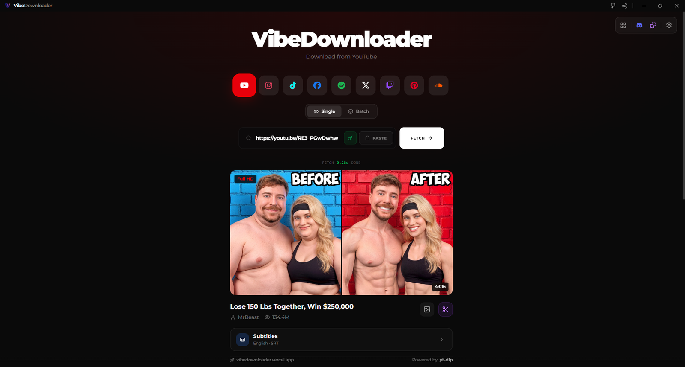<br /><sub><b>Paste a link, fetch, choose</b></sub></td>
<td width="50%" align="center">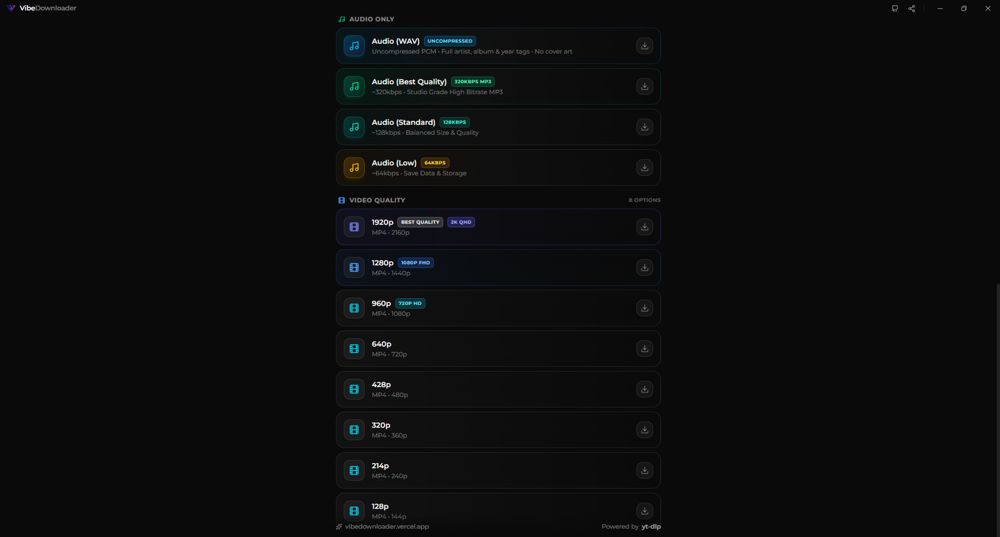<br /><sub><b>Every audio &amp; video quality, up to the best available</b></sub></td>
</tr>
<tr>
<td align="center">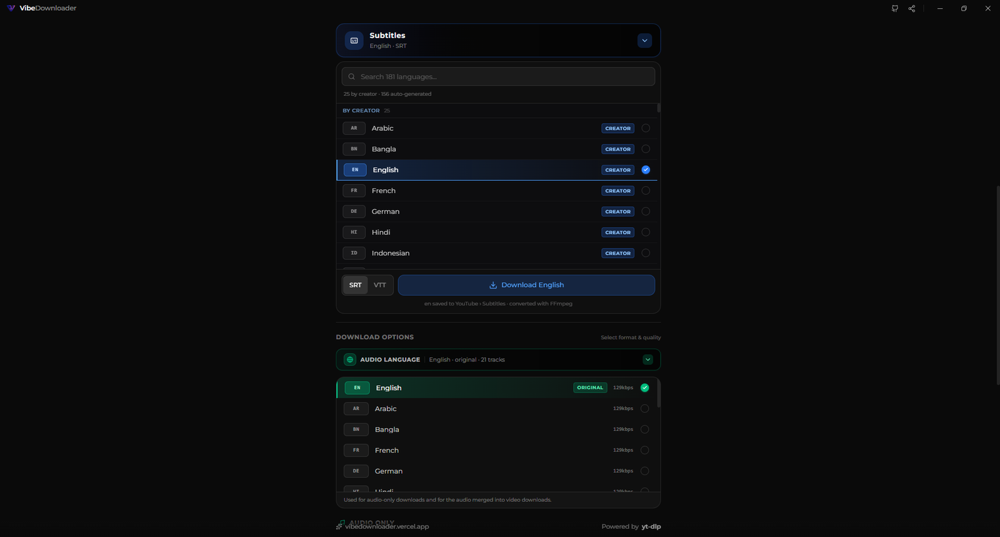<br /><sub><b>Subtitles &amp; audio languages</b></sub></td>
<td align="center">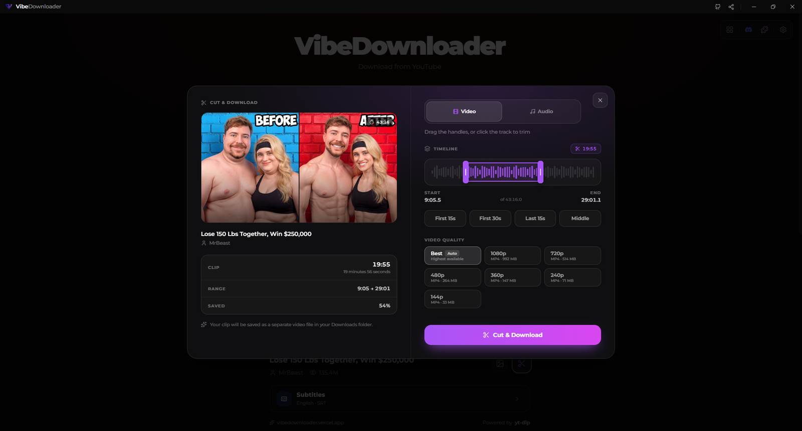<br /><sub><b>Cut &amp; Download — trim before you save</b></sub></td>
</tr>
<tr>
<td align="center">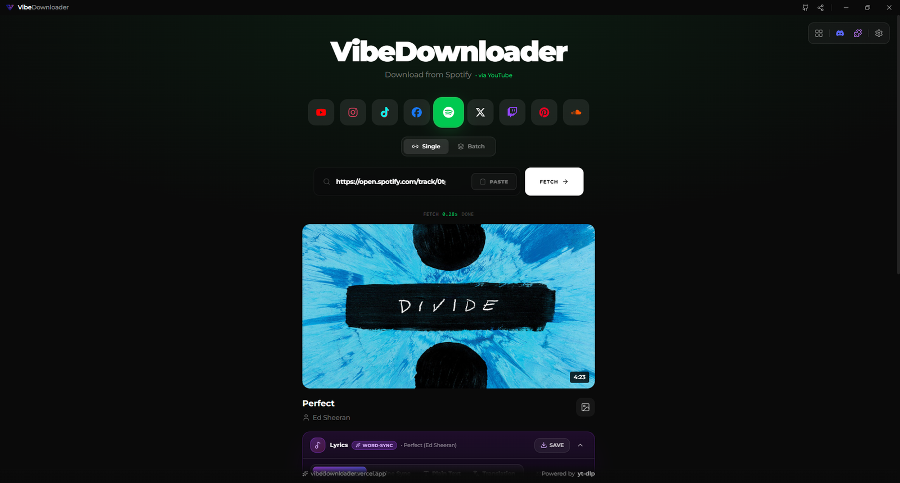<br /><sub><b>Spotify tracks with full metadata</b></sub></td>
<td align="center">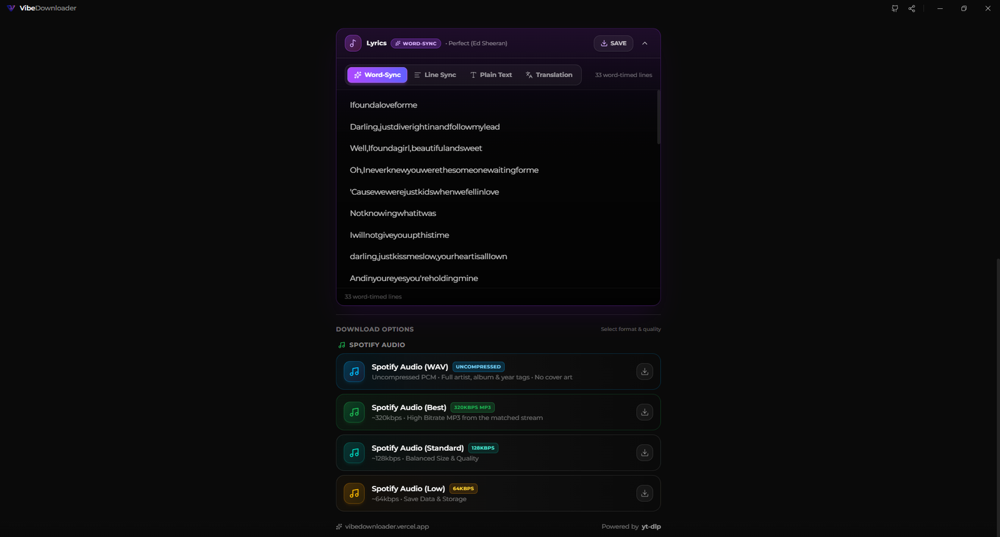<br /><sub><b>Lyrics — line by line, word by word, plain text</b></sub></td>
</tr>
<tr>
<td align="center">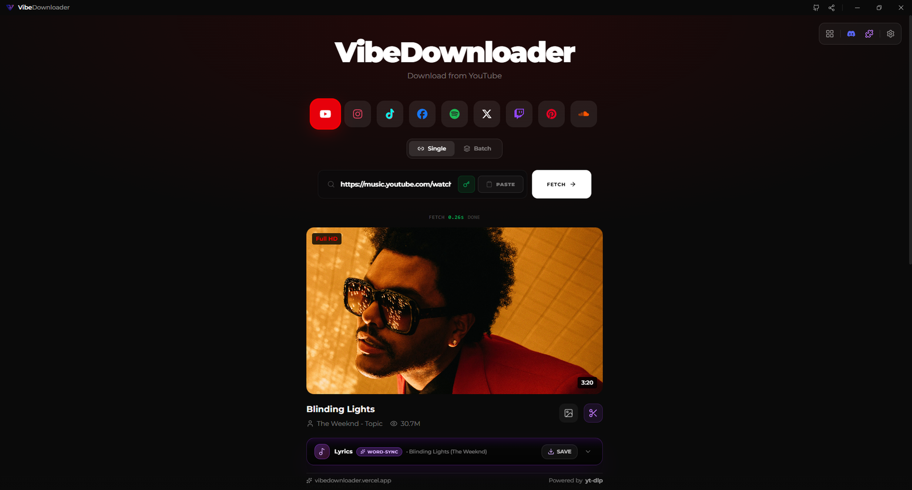<br /><sub><b>YouTube Music with lyrics</b></sub></td>
<td align="center">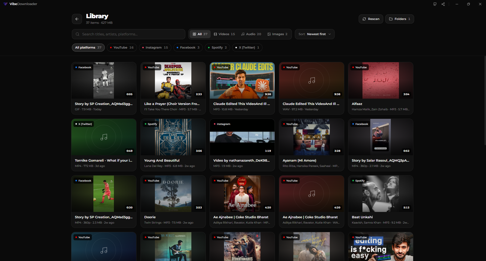<br /><sub><b>Media Library</b></sub></td>
</tr>
<tr>
<td align="center">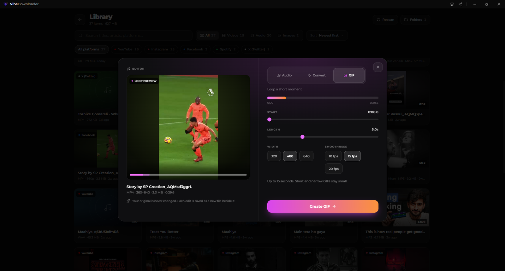<br /><sub><b>Editor — loop a moment as a GIF</b></sub></td>
<td align="center">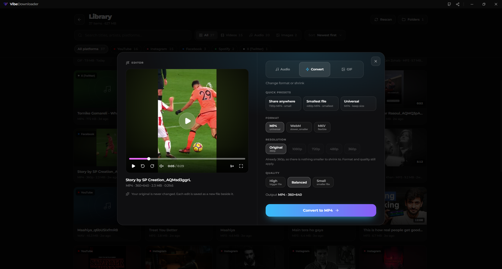<br /><sub><b>Editor — convert format &amp; size</b></sub></td>
</tr>
</table>


<a id="features"></a>

## ✨ Features

Everything VibeDownloader can do, grouped by what you want to get done.

### 📥 Download

<table>
<tr>
<td width="50%" valign="top">

**🎥 Multi-platform downloads**<br />
Videos, reels, shorts, stories and playlists from nine platforms, from one clean window.

</td>
<td width="50%" valign="top">

**📦 Batch downloading**<br />
Queue videos and audio with per-item quality controls and pause / resume.

</td>
</tr>
<tr>
<td valign="top">

**🔴 Twitch live recording**<br />
Record any live broadcast until you stop. It is finalized as a playable MP4.

</td>
<td valign="top">

**📂 Smart organization**<br />
Files are sorted into folders by platform and content type (Live, VODs, Clips, Playlists), and each platform folder gets its own icon.

</td>
</tr>
</table>

### 🎵 Music, Lyrics & Subtitles

<table>
<tr>
<td width="50%" valign="top">

**🎧 Studio-quality music**<br />
WAV export, plus embedded track, album and artist details and cover art, so songs look right in any music player.

</td>
<td width="50%" valign="top">

**🎤 Lyrics**<br />
Line by line, word by word, plain text, or translated, for Spotify and YouTube Music tracks.

</td>
</tr>
<tr>
<td valign="top">

**💬 Subtitles**<br />
Save subtitles as SRT.

</td>
<td valign="top">

**🌍 Audio languages**<br />
When a video has several audio tracks, choose the exact language, as audio only or as a video.

</td>
</tr>
</table>

### ✂️ Edit & Convert

<table>
<tr>
<td width="50%" valign="top">

**✂️ Cut & Download**<br />
Trim any video or song with the waveform timeline before saving. Clean output, no leftovers.

</td>
<td width="50%" valign="top">

**🗂️ Media Library**<br />
Browse everything you've downloaded, and anything already in your folders. Search, filter and sort.

</td>
</tr>
<tr>
<td valign="top">

**✨ Built-in editor**<br />
Extract audio, convert formats or make a GIF from any item in your Library. Your original is never changed.

</td>
<td valign="top">

**🎞️ Plays everywhere**<br />
Files are checked and converted only when needed, using your GPU when it is faster, so they open in QuickTime, VLC, editors and on phones.

</td>
</tr>
</table>

### 🧩 Convenience

<table>
<tr>
<td width="50%" valign="top">

**🧩 Browser extension**<br />
One-click download buttons right on the page, sent straight to the desktop engine.

</td>
<td width="50%" valign="top">

**📥 System tray**<br />
Keep the app running in the background for instant access.

</td>
</tr>
<tr>
<td valign="top">

**💾 Light on disk**<br />
Already have FFmpeg? VibeDownloader uses it instead of downloading its own copy (about 190 MB).

</td>
<td valign="top">

**🍪 Optional sign-in**<br />
Add cookies for age-restricted videos or private accounts. They stay on your computer.

</td>
</tr>
</table>

<a id="platforms"></a>

## 🌐 Supported Platforms

<table>
<tr>
<td align="center" width="56"></td>
<td><b>YouTube &amp; YouTube Music</b></td>
<td>Videos, Shorts, playlists, subtitles (SRT), audio languages, lyrics</td>
</tr>
<tr>
<td align="center"></td>
<td><b>Spotify</b></td>
<td>Tracks, albums &amp; playlists with full metadata and cover art — 4 audio formats up to lossless &amp; hi-res, plus lyrics</td>
</tr>
<tr>
<td align="center"></td>
<td><b>Instagram</b></td>
<td>Videos, reels and stories</td>
</tr>
<tr>
<td align="center"></td>
<td><b>TikTok</b></td>
<td>Videos, including private ones with a signed-in session</td>
</tr>
<tr>
<td align="center"></td>
<td><b>Facebook</b></td>
<td>Videos, reels and stories</td>
</tr>
<tr>
<td align="center"></td>
<td><b>X (Twitter)</b></td>
<td>Videos</td>
</tr>
<tr>
<td align="center"></td>
<td><b>Twitch</b></td>
<td>VODs, clips and <b>live recording</b> — finalized as a playable MP4</td>
</tr>
<tr>
<td align="center"></td>
<td><b>Pinterest</b></td>
<td>Videos</td>
</tr>
<tr>
<td align="center"></td>
<td><b>SoundCloud</b></td>
<td>Audio</td>
</tr>
</table>


<a id="install"></a>

## 📥 Install

Download the installer for your system from the [**Releases page**](https://github.com/naeem5877/vibedownloader-desktop/releases/latest), then follow the matching guide.

| System | Download | Guide |
| --- | --- | --- |
| 💻 **Windows** | `.exe` installer | [Windows →](#install-windows) |
| 🍎 **macOS** | `.dmg` | [macOS →](#install-macos) |
| 🐧 **Linux** | `.AppImage` or `.deb` | [Linux →](#install-linux) |
| 📱 **Android** | `.apk` | [Android →](#android) |

> **First launch:** VibeDownloader sets up its downloader (yt-dlp) by itself. If FFmpeg isn't already on your computer, it downloads one once (about 190 MB). If you already have FFmpeg, it is used as is.

<a id="install-windows"></a>

### 💻 Windows

1. Run the downloaded **`.exe`** and follow the setup wizard.
2. Open **VibeDownloader** from the Start Menu.

---

<a id="install-macos"></a>

### 🍎 macOS

1. Open the downloaded **`.dmg`**.
2. Drag **VibeDownloader** into **Applications**.
3. Open it from Applications.

> **⚠️ "VibeDownloader is damaged and can't be opened"?**
> Expected: the app isn't signed with an Apple Developer ID yet ($99/year). Run this **once** in Terminal, then open the app normally:
>
> ```bash
> xattr -c /Applications/VibeDownloader.app
> ```
>
> It only removes macOS quarantine flags, and the code is fully open source if you'd like to inspect it first.

---

<a id="install-linux"></a>

### 🐧 Linux

**AppImage** (most distributions)

```bash
chmod +x VibeDownloader-*.AppImage
./VibeDownloader-*.AppImage
```

**Debian / Ubuntu** (`.deb`)

```bash
sudo dpkg -i VibeDownloader-*.deb
```

---

<a id="whats-new"></a>

## 🆕 What's New in v2.3.0

> **Coming in the next release.** The latest published version is always shown in the *Latest* badge at the top.

<table>
<tr>
<td width="50%" valign="top">

### 🗂️ Media Library
A gallery of everything you've downloaded, and anything already in your folders. Search, filter by type, sort, rescan and add more folders to watch.

### ✨ Built-in Editor
Extract audio as MP3 or M4A, convert to MP4, WebM or MKV, or make a GIF of up to 15 seconds. Each edit is saved as a new file; **your original is never changed**.

### ⚡ Much Faster Conversion
Uses your GPU when it is genuinely faster, tunes the CPU encoder to your PC, and **cuts first, converts second**, so a 2-minute clip from a 1-hour video only converts 2 minutes. Live progress shows speed and time left.

### 🚀 Faster YouTube Links
Single YouTube videos load in a fraction of a second, with an automatic fallback to the regular method.

### 💾 Uses Your FFmpeg
Already have FFmpeg installed? It is used as is, saving a ~190 MB download.

</td>
<td width="50%" valign="top">

### 📊 Clearer Progress
A step-by-step timeline (Preparing, Downloading, Processing, Finishing up) and a better link-lookup screen.

### ✅ New "Download complete" Screen
**Open file**, **Show in folder** and **Copy path** buttons, plus **Download another quality of this video** without fetching again.

### ✂️ Redesigned Cut & Download
A cleaner timeline with fixed Start / End readouts, a Video / Audio switch, compact quality chips and a button that stays in view. Clips can't be shorter than 1 second.

### 📁 Branded Download Folders
Matching icons on Windows, macOS and Linux. Folders where you already picked a custom icon are left alone.

### 🎨 Fresh Look
Redesigned Settings and sign-in window, and smoother animations.

### 🧩 Extension Fixes
The **Spotify** button works again on Spotify's new player bar, and the **YouTube** button no longer disappears when you move to the next video.

</td>
</tr>
</table>

<details>
<summary><b>Previous release — v2.2.0</b></summary>

<br />

- 🎞️ **Plays everywhere** — downloads are checked and, when needed, converted to H.264 + AAC, so videos open in QuickTime, VLC, Premiere, DaVinci Resolve, CapCut and on phones
- 🔇 **No more "audio only" videos** in QuickTime and editors
- ⚙️ **Smarter conversion** — only the stream that needs fixing is re-encoded, so most files finish quickly
- 🍎 **macOS yt-dlp fix** — resolves `spawn yt-dlp ENOENT` and the first-launch failure on Mac & Linux
- 🧰 **ffprobe on Mac** — a missing ffprobe is fetched automatically, so conversion no longer gets skipped
- 📍 **Mac & Linux polish** — correct menu-bar icon size, Homebrew/Snap tools detected, extension setup for more browsers
- 🔄 **Safer yt-dlp updates** — a failed update never leaves you without a working downloader
- 🎨 **New TikTok icon** with the classic cyan & red glitch style

</details>

See every change in the [changelog](CHANGELOG.md) and on the [**Releases page**](https://github.com/naeem5877/vibedownloader-desktop/releases).


## 🔌 More Ways to Use VibeDownloader

The desktop app is the core. These add-ons bring it to your browser, your phone and your video editor.

<a id="extension"></a>

### 🧩 Browser Extension

Download directly from the page — no copying links, no switching tabs.

- **One-click download buttons** on YouTube (incl. Music), Instagram, Facebook, TikTok, X (Twitter), Spotify and SoundCloud
- **Native messaging bridge** — the extension talks to your desktop app over a secure local connection and can even launch the app for you
- **Full desktop engine** — every download gets best-quality processing, smart organization and the Cut feature

**Install it (bundled with the desktop app)**

1. Install **VibeDownloader** for desktop
2. In the app, click the **Extension** button (top-right corner)
3. Pick your browser — the app detects supported browsers and shows you the exact steps
4. It prepares the ready-to-load folder. Then open `chrome://extensions` (or the equivalent) → turn on **Developer mode** → **Load unpacked** → select the revealed folder

> ✅ Chrome, Edge, Brave, Vivaldi, Opera and Firefox are supported. The extension ships inside the installer — no separate download needed.

<a id="android"></a>

### 📱 Android App

**VibeDownloader is also on your phone.** The same private, ad-free downloader, built natively for Android, so you can save videos, music and stories wherever you are.

<a href="https://github.com/naeem5877/vibedownloader-android/releases/latest"></a>
<a href="https://github.com/naeem5877/vibedownloader-android/releases/latest"></a>
<a href="https://github.com/naeem5877/vibedownloader-android/releases"></a>

<table>
<tr>
<td width="25%" align="center"></td>
<td width="25%" align="center"></td>
<td width="25%" align="center"></td>
<td width="25%" align="center"></td>
</tr>
</table>

**What you get on Android**

- 📲 **Share to download** — tap Share in YouTube, Instagram, TikTok or any app, pick VibeDownloader, done
- 🎥 **All the major platforms** — YouTube, Instagram, TikTok, Facebook, X, Spotify, Pinterest, SoundCloud and Twitch, including Instagram and Facebook **Stories**
- 💬 **Subtitles & audio languages** — save SRT subtitles and choose the exact audio language
- 🎤 **Lyrics** — line by line, word by word, plain text or translated, for Spotify and YouTube Music
- 🎧 **Studio-quality music** — MP3 and WAV with track, album, artist and cover art embedded
- ✂️ **Cut & Download** — save just the part you want
- 📦 **Batch downloads**, a **smart library** and **gallery integration**, so files show up in your photos and music apps
- 🔒 **Private** — no accounts, no ads, nothing leaves your device
- 🌙 Dark mode, internal or SD card storage, battery-friendly downloads

**Requirements:** Android 7.0 (API 24) or newer.

**Install**

1. Download the **`.apk`** from the [**Android Releases page**](https://github.com/naeem5877/vibedownloader-android/releases/latest)
2. Allow **Install from unknown sources** for your browser or file manager when Android asks
3. Open the APK and tap **Install**
4. Launch **VibeDownloader** from your app drawer

> **Why not the Play Store?** To avoid Play Store restrictions and keep every feature available, the Android app is only distributed through GitHub releases. It is fully open source, so you can inspect the code first.

[**View the Android repository →**](https://github.com/naeem5877/vibedownloader-android)

<a id="premiere-plugin"></a>

### 🎬 For Editors: Vibe Plugin for Adobe Premiere Pro

<table>
<tr>
<td width="55%" valign="top">

**Download, import and edit without leaving Premiere.** Vibe Plugin is a free, open-source panel that puts a YouTube and social video downloader inside Adobe Premiere Pro.

- 🔎 **Search YouTube or paste a link**, pick a quality, and the file lands in your **project bin** or straight on your **timeline**
- 🎞️ **Premiere-ready H.264** — VP9 and AV1 are converted while they download
- 🎵 **Audio as M4A, MP3 or WAV**
- 📦 **Free stock library** — Pexels, Pixabay and Unsplash video, music and sound effects
- 🔒 **Local and private** — no accounts, no ads, powered by `yt-dlp`

<a href="https://github.com/naeem5877/vibe-plugin/releases/latest"></a>
<a href="https://github.com/naeem5877/vibe-plugin/releases/latest"></a>

[**Vibe Plugin on GitHub →**](https://github.com/naeem5877/vibe-plugin)

</td>
<td width="45%" align="center" valign="middle"><a href="https://github.com/naeem5877/vibe-plugin"></a></td>
</tr>
</table>

Install it with the per-user Windows installer (no admin prompt), then **restart Premiere Pro** and open **Window → Extensions → Vibe Plugin**.


## 🛟 Help & Setup

<a id="cookies"></a>

### 🍪 Cookies (Optional)

Some content needs a signed-in session, such as age-restricted videos or private accounts. You can add your cookies for a platform in the app.

- Cookies are stored **only on your computer** and are used only to authenticate your own downloads
- They are never uploaded to any server
- **Tip:** for the most reliable result, export your cookies from a **private/incognito window**, then close that window right away. A browser session that stays open can rotate its cookies and make the exported ones stop working.

<a id="troubleshooting"></a>

### 🧰 Troubleshooting

<details>
<summary><b>A download fails, or only low qualities show up</b></summary>

<br />

1. Open **Settings** and make sure the downloader (yt-dlp) is up to date
2. Try again without cookies, or with freshly exported cookies
3. Turn off any VPN. Some VPN and shared IPs are blocked by YouTube
4. If it still fails, open a [new issue](https://github.com/naeem5877/vibedownloader-desktop/issues) with the video link (a public one), your app version, and your OS

</details>

<details>
<summary><b>"FFmpeg could not be downloaded", or video and audio processing doesn't work</b></summary>

<br />

VibeDownloader uses the FFmpeg already on your computer when it has a complete one, and otherwise downloads its own copy once (about 190 MB). If that download is blocked by your network, firewall or antivirus, install FFmpeg yourself, then **restart VibeDownloader**:

```bash
# Windows
winget install Gyan.FFmpeg

# macOS
brew install ffmpeg

# Debian / Ubuntu
sudo apt install ffmpeg
```

On Linux, avoid the Snap package of FFmpeg. Snap blocks it from reading the app's files, so VibeDownloader skips it.

</details>

<details>
<summary><b>The extension button doesn't show up</b></summary>

<br />

Reload the extension on your browser's extensions page, then refresh the site's tab. If it still doesn't appear, check that the desktop app is installed and was opened at least once so the local connection is registered.

</details>

<a id="faq"></a>

### ❓ FAQ

<details>
<summary><b>Is VibeDownloader free and safe?</b></summary>

<br />

Yes. It is free, ad-free and open source under GPL v3.0, so you can read every line. Downloads and cookies stay on your device.

</details>

<details>
<summary><b>Which sites can I download from?</b></summary>

<br />

YouTube, YouTube Music, Spotify, Instagram, TikTok, Facebook, X (Twitter), Twitch, Pinterest and SoundCloud. See [Supported Platforms](#platforms).

</details>

<details>
<summary><b>Where do my downloads go?</b></summary>

<br />

Into a **VibeDownloader** folder inside your Downloads folder, sorted by platform and type (for example `YouTube/Videos` or `Spotify/Music`). You can change the location in **Settings**, and everything shows up in the Library.

</details>

<details>
<summary><b>Do I need to install FFmpeg?</b></summary>

<br />

No. If your computer already has a complete FFmpeg, VibeDownloader uses it. If not, it downloads its own copy once, the first time you need it.

</details>

<details>
<summary><b>Is there a version for Adobe Premiere Pro?</b></summary>

<br />

Yes. [Vibe Plugin](https://github.com/naeem5877/vibe-plugin) is a free panel that downloads into your project bin or timeline. See [For Editors](#premiere-plugin).

</details>

<details>
<summary><b>Can I download a whole YouTube playlist, or just a clip?</b></summary>

<br />

Both. Paste a playlist link to queue it, or use **Cut & Download** to save only the part you want.

</details>

<details>
<summary><b>Can it save MP3, WAV or high-quality audio?</b></summary>

<br />

Yes. Save audio as MP3 or WAV, and Spotify tracks in up to lossless and hi-res formats, with cover art and tags embedded.

</details>

<details>
<summary><b>Why do my downloaded videos play in QuickTime, VLC and editors?</b></summary>

<br />

Files are checked and, only when needed, converted to H.264 + AAC. A GPU is used automatically when it is faster.

</details>

<a id="privacy"></a>

### 🔐 Privacy

- Downloads, conversions and cookies are processed **locally on your device**
- No accounts, no ads
- **Crash and error reports:** VibeDownloader uses [Sentry](https://sentry.io) to find and fix bugs. Links and file paths are scrubbed before anything is sent, and cookies are never included
- You can read exactly what is collected in this repository — the app is fully open source


<a id="develop"></a>

## 🛠️ For Developers

Built with **Electron**, **React**, **Vite** and **TypeScript** (Desktop) | **React Native** (Android).

### Desktop Development

```bash
# Clone the repository
git clone https://github.com/naeem5877/vibedownloader-desktop.git

# Navigate to the project directory
cd vibedownloader-desktop

# Install dependencies
npm install

# Start development server
npm run dev
```

#### Build Commands

```bash
# Build for Windows
npm run pack:win

# Build for macOS
npm run pack:mac

# Build for Linux
npm run pack:linux
```

#### Project Structure

```
vibedownloader-desktop/
├── src/              # React UI (components, styles)
├── electron/         # Electron main process, handlers and utilities
├── extension/        # Browser extension (per-platform content scripts)
├── native-host/      # Native messaging host for the extension
├── build/            # Build resources and folder icons
├── scripts/          # Dev and test scripts
├── public/           # Static assets
└── Screenshots/      # README images and showcase
```

### Android Development

For Android development instructions, visit the [**Android Repository**](https://github.com/naeem5877/vibedownloader-android).

### 🤝 Contributing

Contributions are welcome and appreciated! Here's how you can help:

1. **Fork** the repository (Desktop or Android)
2. Create a **feature branch** (`git checkout -b feature/amazing-feature`)
3. **Commit** your changes (`git commit -m 'Add some amazing feature'`)
4. **Push** to the branch (`git push origin feature/amazing-feature`)
5. Open a **Pull Request**

Please follow our [Code of Conduct](CODE_OF_CONDUCT.md) and [Contributing Guide](CONTRIBUTING.md).

**Areas we'd love help with**

- 🐛 Bug fixes and stability improvements
- 🌐 Translation and internationalization
- 📝 Documentation improvements
- ✨ New feature development
- 🎨 UI/UX enhancements
- 📱 Android-specific optimizations


## 📄 License & Brand

| | |
| --- | --- |
| **Code** | [GNU GPL v3.0](LICENSE) — view, modify and redistribute, as long as you share the source, state your changes and keep the same license. |
| **Brand** | The **VibeDownloader** name, logo and branding are reserved. |

**Forks and modified versions must not** use the VibeDownloader name or logo, or present themselves as an official build. This keeps official releases easy to tell apart from community forks.

## 📞 Support & Community

<div align="center">

[](https://github.com/naeem5877/vibedownloader-desktop/issues)
[](https://github.com/naeem5877/vibedownloader-android/issues)

</div>

- 🐛 **Found a bug?** [Desktop Issues](https://github.com/naeem5877/vibedownloader-desktop/issues) | [Android Issues](https://github.com/naeem5877/vibedownloader-android/issues)
- 💡 **Have an idea?** [Start a discussion](https://github.com/naeem5877/vibedownloader-desktop/discussions)
- ⭐ **Like the project?** Give it a star on both repositories!

### ⭐ Star History

<div align="center">
  <a href="https://star-history.com/#naeem5877/vibedownloader-desktop&Date">
    
  </a>
</div>

## 🙏 Acknowledgments

- Built with [yt-dlp](https://github.com/yt-dlp/yt-dlp) — the powerful video downloader
- Desktop powered by [Electron](https://www.electronjs.org/) — cross-platform desktop framework
- Android powered by [React Native](https://reactnative.dev/) — mobile framework
- UI built with [React](https://reactjs.org/) and [Vite](https://vitejs.dev/)


<div align="center">

### Made with ❤️ by [Naeem](https://github.com/naeem5877)

**If you find this project useful, consider giving it a ⭐**

<sub>© 2026 VibeDownloader. Released under GPL v3.0 License.</sub>

</div>
